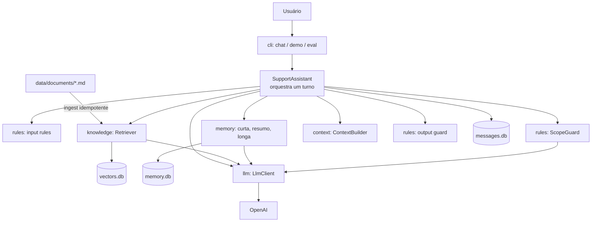

# Arquitetura

O FlowDesk Support Assistant é uma plataforma de contexto: o modelo de linguagem é só um componente, e tudo o que ele **vê** (contexto), **lembra** (memória), **pode dizer** (regras) e **sabe** (conhecimento) é controlado por módulos próprios, testáveis isoladamente.

## Visão geral

## Fluxo de um turno

`SupportAssistant.handleTurn` apenas **ordena** as etapas; cada decisão mora em um módulo.

| # | Etapa | Módulo | Se falhar |
|---|-------|--------|-----------|
| 1 | Regras de entrada (vazio, tamanho, credenciais, injection) | `rules/inputRules` | recusa, **0 chamadas ao modelo** |
| 2 | Carrega memória da sessão (resumo + mensagens recentes) | `memory/SummaryMemory`, `ShortTermMemory` | — |
| 3 | Classifica o escopo (`in_scope`, `out_of_scope`, `injection`, `smalltalk`) | `rules/ScopeGuard` | recusa; saudação responde sem modelo |
| 4 | Aprende e recupera fatos duráveis do usuário | `memory/LongTermMemory` | — |
| 5 | Busca na documentação (híbrida: semântica + palavras-chave) | `knowledge/Retriever` | sem trecho relevante: "não encontrei", **0 chamadas de geração** |
| 6 | Monta o contexto dentro do orçamento de tokens | `context/ContextBuilder` | descarta o menos valioso |
| 7 | Gera a resposta | `llm/LlmClient` | — |
| 8 | Valida a saída (citações, números, vazamento, promessas) | `rules/outputGuard` | troca por resposta segura |
| 9 | Persiste o turno e comprime a conversa se passou do limite | `repositories`, `SummaryMemory` | — |

O resultado (`TurnResult`) traz `answer`, `outcome`, `sources` (só as fontes citadas) e `trace`, a trilha de auditoria com cada regra que decidiu.

## Camadas e responsabilidades

| Pasta | Responsabilidade | Depende de |
|-------|------------------|------------|
| `src/config` | Caminhos e parâmetros (`settings.ts`): modelos, limites, thresholds | — |
| `src/llm` | Interface `LlmClient` (`chat`, `embed`) e adaptador OpenAI com retry | config, shared |
| `src/knowledge` | Carregar `.md`, dividir por seção, ingerir, buscar | llm, repositories |
| `src/memory` | Memória curta, resumo e longa | llm, repositories |
| `src/context` | Prompts e `ContextBuilder` | knowledge (tipos) |
| `src/rules` | Entrada, escopo, saída, textos de recusa | llm, shared |
| `src/assistant` | Orquestração do turno e composição das dependências reais | todas |
| `src/repositories` | SQLite: mensagens, vetores, resumos e fatos | config |
| `src/cli` | Interfaces de terminal: chat, demo, eval, ingest | assistant |
| `src/shared` | Tipos, texto, retry, detecção de dados sensíveis | — |

Regras de dependência: `rules` e `context` não conhecem SQLite; `assistant` é o único que conhece todos os módulos; só `createAssistant` instancia o cliente OpenAI. Todo o resto recebe suas dependências pelo construtor, por isso os testes substituem o modelo por um fake.

## Decisões de projeto

- **Defesa em profundidade para o escopo.** Três barreiras independentes: regras de entrada (determinísticas), classificador de escopo (modelo, falha fechada) e recuperação (sem documentação não há resposta). Mesmo que uma falhe, as outras seguram.
- **Sem documentação, sem geração.** Quando a busca não encontra nada acima do `minScore`, o assistente nem chama o modelo de resposta. É a principal redução de alucinação: o modelo não tem a chance de inventar.
- **Resposta só passa se for rastreável.** O `outputGuard` exige citação de fonte existente e que todo número citado (preço, limite, prazo) apareça na documentação.
- **Resposta completa, não streaming.** A saída é validada antes de chegar ao usuário; por isso `LlmClient` não faz streaming.
- **Memória com três escalas.** Curta (conversa), resumo (conversa longa) e longa (fatos do usuário entre sessões), cada uma com sua tabela e política.
- **Busca por força bruta.** `VectorRepository.search` compara a pergunta com todos os vetores. Para a escala do projeto (dezenas de chunks) é simples e suficiente; para milhares de chunks, trocar por um índice vetorial (sqlite-vec, pgvector) mantendo a mesma interface.
- **Embeddings consistentes com o texto.** Cada chunk começa com "Título — Seção", então o vetor carrega o tópico mesmo quando o corpo é genérico.

## Dados

| Arquivo | Conteúdo |
|---------|----------|
| `data/documents/*.md` | Base de conhecimento (versionada) |
| `data/db/vectors.db` | Chunks com embeddings e hash de conteúdo (gerado) |
| `data/db/messages.db` | Histórico por sessão (gerado) |
| `data/db/memory.db` | Resumos por sessão e fatos por usuário (gerado) |

Os bancos em `data/db/` são gerados e ignorados pelo Git.
